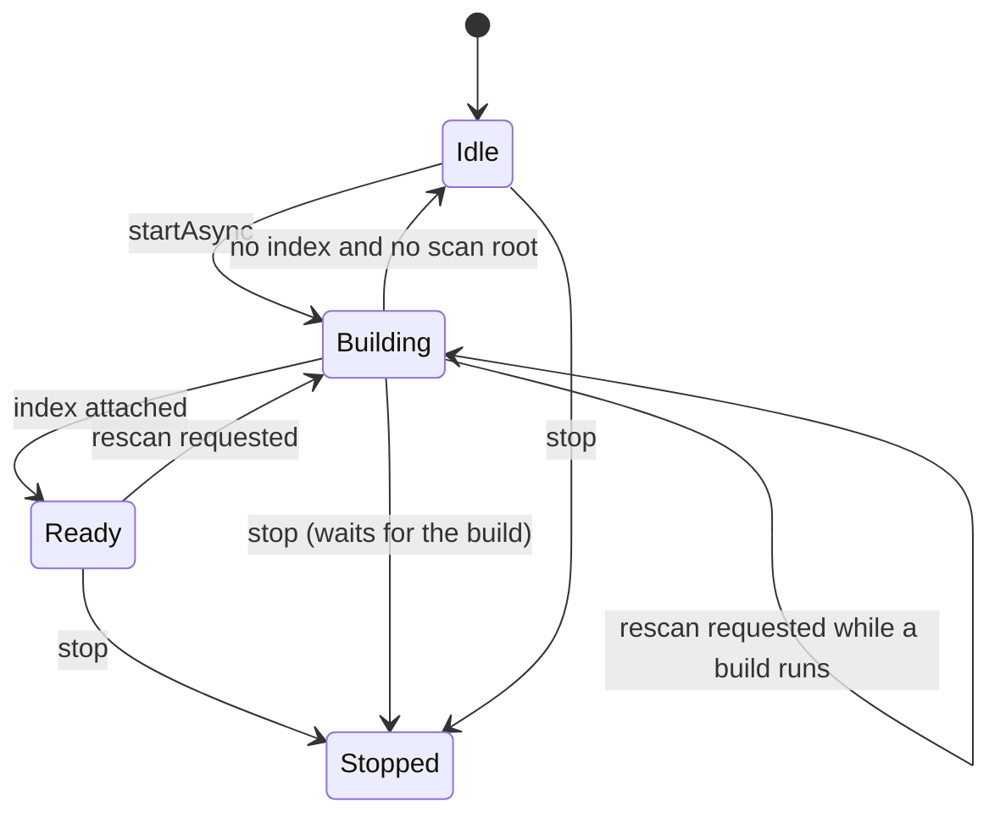

# State machines of the Zig port

## At a glance

The port keeps most of its state as row indexes, raw pointers, and flags. A reload, a sort, a tab change, or a lost FSEvents batch could change that state between two reads. An action then hit a different file or a freed object.

The fixes bind each action to a name or an owned copy. They also add the missing transitions: rescan, modal overlay, and safe teardown. The 20 regression tests are in `zig/tests_state.zig`. The index file format, the search tiers, the ranking, and the view layout stay unchanged.

This file covers `zig/` only. "Before" means the code as it was on 2026-11-24 before this work. Line numbers refer to the code after the fixes.

## How to read this file

Each machine has its states, its invariants, and a transition table. A row marked **was broken** names the finding that fixed it. Section "Findings" gives the evidence for each finding. Section "Issues" groups the fixes. Section "Open hazards" lists what is still not fixed.

Evidence labels:

- **Reproduced**: a test failed on the old code and passes now. The quoted line is the test output from the old code.
- **By reading**: the finding names the code path, but no test reached it.
- **Not verified**: a suspicion that needs a check in the running app.

---

## 1. Engine worker (`engine.zig`)

Explicit state: `worker`, `indexing`, `rescan_wanted`, `stopping`, `ready`, `live`, `stream`, `cfg`.



| State | `indexing` | `live` | `worker` |
| --- | --- | --- | --- |
| Idle | false | null | null |
| Building | true | null or old index | running |
| Ready | false | set | finished, not yet joined, or null |
| Stopped | false | null after `deinit` | null |

Invariants:

1. At most one worker thread exists. `spawnWorkerLocked` joins the finished one before it starts the next (`engine.zig:125`).
2. `worker`, `stream`, and `live` change only while `mutex` is held.
3. `indexing` goes false only inside the same lock that reads `rescan_wanted` (`engine.zig:346`). A request can not fall between the two.
4. `cfg` does not change while `indexing` is true (`configure` returns `error.WorkerRunning`).
5. No thread calls `Stream.destroy` or `Thread.join` on a running worker while it holds `mutex`.

| From | Event | Guard | To | Action |
| --- | --- | --- | --- | --- |
| Idle | `startAsync` | not indexing | Building | store `cfg`, spawn worker |
| Building | index loaded or built | not stopping | Ready | `attachLive`, replace stream, wake UI |
| Building | load and scan both fail | | Idle or Ready (old index kept) | none |
| Ready | `requestRescan` | scan root set, not stopping | Building | spawn worker with `force_scan` (**was broken**: D1) |
| Building | `requestRescan` | | Building | set `rescan_wanted`; the worker loops once more |
| any | `stop` | | Stopped | set `stopping`, clear waker, join worker, destroy stream |

## 2. Index freshness (`engine.zig`, `live.zig`)

Implicit state. The index is **Fresh** when the engine applied every FSEvents batch since `base.event_id`. It is **Stale** when the system lost a batch or the engine could not apply one.

| From | Event | To | Action |
| --- | --- | --- | --- |
| Fresh | event for one folder | Fresh | `Live.applyDir(path, false)` |
| Fresh | `MUST_SCAN_SUBDIRS` for a folder | Fresh | `applyDir(path, true)` rescans that subtree |
| Fresh | `MUST_SCAN_SUBDIRS` for `/` | Stale | `applyDir` returns true (**was broken**: D1, result was dropped) |
| Fresh | `USER_DROPPED` or `KERNEL_DROPPED` | Stale | (**was broken**: D1, flag was skipped) |
| Fresh | `applyDir` fails (out of memory) | Stale | treated as "must rescan" |
| Stale | worker finishes a full scan | Fresh | new `Live`, new stream from the scan's event id |

Invariant: Stale always leads to a rescan request. `applyEvents` is the only place that reads the flags (`engine.zig:238`).

Each `Live` has an `epoch` (`live.zig:87`). `SearchCache` holds name ids of one index. It is valid only for the `Live` with the same epoch (`search.zig:99`).

## 3. FSEvents stream (`fsevents.zig`)

States: **Running** (callbacks can run on the stream's serial queue), **Draining**, **Freed**.

| From | Event | To | Action |
| --- | --- | --- | --- |
| none | `watch` | Running | create, set queue, start |
| Running | `destroy` | Draining | stop, invalidate |
| Draining | queue is empty | Freed | release stream and queue, free `Stream` |

Invariant: no callback runs after `destroy` returns. `destroy` runs an empty block with `dispatch_sync_f` on the queue before it frees the `Stream` (`fsevents.zig:114`) (**was broken**: E1). The caller must not hold `Engine.mutex`, and must not be the queue itself.

## 4. Live overlay entry (`live.zig`)

One path is in exactly one of these states.

| State | Base entry | Overlay slot |
| --- | --- | --- |
| Unknown | none | none |
| Base | alive | none or dead |
| Replaced | dead bit set | alive |
| Added | none | alive |
| Removed | dead bit set, or none | dead, or none |

Invariants:

1. A path is never alive in both the base and the overlay.
2. `killSubtree` sets the dead bit on a folder and on every base descendant.
3. One path owns at most one overlay slot for the life of the `Live`. A dead slot stays in `overlay_map`, and `putOverlay` revives it (`live.zig:236`) (**was broken**: F1).
4. Every reader checks `alive` after `lookupOverlay`.

| From | Event | To |
| --- | --- | --- |
| Unknown | found on disk by `applyDir` | Added |
| Base | attributes or kind changed | Replaced |
| Base | folder's date changed only | Base, with a `dir_overrides` entry |
| Base, Replaced, Added | missing on disk | Removed |
| Removed | found on disk again | Added or Replaced (same slot) |

## 5. Tab history (`app.zig`, `Tab`)

State: `path`, `history`, `hist_pos`.

Invariants:

1. `history[hist_pos]` equals `path`.
2. `history` holds 1 to 64 paths.
3. `path` is always a valid owned string.

| Event | Guard | Result |
| --- | --- | --- |
| `navigateTo(p, push)` | folder opens, `p` differs | truncate forward history, push `p`, `hist_pos` = last |
| `navigateTo(p, push)` | folder does not open | no change (**was broken**: C1 corrupted `path`) |
| `goBack`, `goForward` | target folder opens | `hist_pos` moves by one |
| `goBack`, `goForward` | target folder does not open | no change, warning toast (**was broken**: C2) |
| reload | current folder is gone | navigate to the nearest parent that exists (**was broken**: C4) |

`navigateTo` copies its argument before it frees anything (`app.zig:209`). Callers pass slices of `tab.path`, of search results, and of history entries.

## 6. Tab set (`app.zig`)

Invariants: `tabs.len >= 1`, `active_tab < tabs.len`, and `listing.path` equals the active tab's `path`.

| Event | Result |
| --- | --- |
| `newTab` | append a copy of the current path, make it active, load its folder |
| `closeTab(i)`, `i < active_tab` | `active_tab` decreases by one (**was broken**: C3) |
| `closeTab(i)`, `i == active_tab` | the next tab, or the last one, becomes active |
| `switchTab(i)` | load that tab's folder; the selection restarts at the cursor row |

All tabs share one listing. A tab's `selected` set holds entry ids of the listing on screen, so it is valid only for the active tab.

## 7. Listing, cursor, and selection (`app_sel.zig`)

State: `listing`, `filtered_order`, `tab.cursor` (a row index), `tab.selected` (entry ids), `active_tag_filter`.

Invariants:

1. Every id in `selected` is an index into `listing.entries`.
2. `cursor` is a row of `visibleRows()`, or 0 when there are no rows.
3. A reload, a sort, or a filter change does not move the cursor or the selection to a different file.
4. An action reads its targets with `selectedPathsAlloc` (`app_ops.zig:8`). It never reads a row index that an earlier frame stored.

| Event | Cursor | Selection |
| --- | --- | --- |
| `navigateTo`, tab change | row 0, or the clamped row | that one row |
| `reload` (engine generation moved, own file action, Cmd+R, hidden-files switch) | follows its entry by name; clamps when the entry is gone | entries with the same names; entries that are gone drop out (**was broken**: A1) |
| `toggleSort` | follows its entry by id (**was broken**: A3) | unchanged |
| `setTagFilter` | row 0 | that one row |
| rename or New Folder done | the new name | the new name |

`reload` runs on every engine generation change (`view.zig:21`). With FSEvents on, that is each batch for any path on the disk.

## 8. Inline rename (`app.zig`, `app_ops.zig`)

States: **Idle** (`renaming_row == null`) and **Editing** (`renaming_row` set, `rename_from` holds the entry's name).

| From | Event | Guard | To | Action |
| --- | --- | --- | --- | --- |
| Idle | Enter or menu Rename | no overlay, no search, a cursor row exists | Editing | copy the name to `rename_from` |
| Editing | field submitted | | Idle | rename `rename_from`, not the row (**was broken**: A2) |
| Editing | Escape | | Idle | none |
| Editing | reload | name still listed | Editing | `renaming_row` moves to the name's new row |
| Editing | reload | name is gone | Idle | none |
| Editing | sort | | Editing | row follows the entry |
| Editing | navigate, tab change, tag filter, click on another row | | Idle | none |

## 9. Overlay (`app.zig`, `view_overlays.zig`)

States: `none`, `go_or_search`, `new_folder`, `confirm_delete`.

Invariants:

1. The only transitions are `none` to one overlay, and that overlay back to `none` (**was broken**: A7).
2. `delete_targets` is non-empty exactly while the state is `confirm_delete`. It is an owned copy of the paths taken when the dialog opened.
3. File actions and file shortcuts do nothing while an overlay is open or a text field has focus (`fileActionsAllowed`, `app.zig:246`).

| From | Event | To | Action |
| --- | --- | --- | --- |
| none | Cmd+K, Cmd+Shift+G | go_or_search | reset the field and the results |
| none | Cmd+Shift+N | new_folder | field = "untitled folder" |
| none | Cmd+Alt+Backspace, with a selection | confirm_delete | copy the selected paths |
| go_or_search | submit a path | none on success; stays open on failure | `navigateTo` |
| new_folder | submit, Create | none | create the folder in the current path |
| confirm_delete | Delete | none | delete `delete_targets` (**was broken**: A1) |
| any overlay | Escape, backdrop, Cancel | none | free `delete_targets` |

## 10. Inline search (`app.zig`, `view_list.zig`)

States: **Browsing** (`search_buf` empty) and **Searching** (text present, results listed in place of the folder).

Invariants:

1. In Searching, the action target is the hit at `search_cursor`, not the hidden folder selection (**was broken**: A4).
2. A navigation ends Searching (**was broken**: C5).
3. A background refresh keeps `search_cursor` on the same path (**was broken**: G1).
4. Inline rename does not start in Searching.

| From | Event | To | Action |
| --- | --- | --- | --- |
| Browsing | text typed | Searching | run the search |
| Searching | text cleared | Browsing | clear the results |
| Searching | Enter, double-click, Cmd+Down | Browsing | open the hit's folder (`openSearchHit`) |
| Searching | sidebar, path bar, Back, Forward, Go | Browsing | navigate |
| Searching | Up, Down | Searching | move `search_cursor` |
| Searching | engine generation moved | Searching | search again, find the same path |
| Searching | tab change with scope "Current Folder" | Searching | search again in the new folder |

## 11. Undo stack (`fs_ops.zig`)

State: `undo_list`, `redo_list`, each a list of (`kind`, `from`, `to`).

Invariants:

1. A new action clears `redo_list`.
2. Undo and redo never replace an item that exists at the destination (**was broken**: B1, B3).
3. Undo of a creation removes only what the app created (**was broken**: B2).
4. The stack drops an entry that fails, and the user sees a toast.

| Kind | Undo | Redo |
| --- | --- | --- |
| rename, move | move `to` back to `from`; fails with `DestinationExists` | move `from` to `to`; same guard |
| trash | move the trashed item back to `from`; same guard | trash `from` again |
| copy | delete the copy | copy again; fails when `to` exists |
| create (folder) | `rmdir`; fails with `FolderNotEmpty` | `mkdir` |
| create (file) | unlink only when the file is still empty | create with `O_EXCL` |

`moveToExactPath` uses `renamex_np` with `RENAME_EXCL` (`fs_ops.zig:106`), so the "destination is free" check and the move are one step.

## 12. Window and waker (`main.zig`, `engine.zig`)

State: `AppState.window`, `Engine.waker_win`. nanoui frees the `Window` object when the window closes.

Invariant: both pointers are null before nanoui frees the window. The `on_close` callback clears them (`main.zig:91`), and `wakeUi` reads `waker_win` under `wake_mutex` (**was broken**: E2).

## 13. Quick Look panel (`quicklook.zig`)

States: **Hidden** and **Visible**. `toggle` copies the target paths and flips the state. See open hazard H5.

---

## Findings

Severity: P0 loses or corrupts user files. P1 leaves the app in a wrong state or can crash. P2 wastes memory or loses UI position.

| ID | Sev | What the code reached | Evidence |
| --- | --- | --- | --- |
| A1 | P0 | A reload replaced the selection with "the row at the cursor index". With 3 files selected and the delete dialog open, one FSEvents batch changed the targets. | Reproduced. `Delete Immediately removes the items the dialog was opened for`: `expected null, found 20`. `c.txt` was confirmed, `b.txt` was deleted. Also `a background reload keeps the selection`: `expected 2, found 1`. |
| A2 | P0 | Inline rename stored a row index. A reload put another file on that row. | Reproduced. `an inline rename survives a reload`: `expected 300, found 1`. The new file `aa.txt` was renamed, not `b.txt`. |
| A3 | P1 | A sort changed the rows but not the cursor index. Enter then renamed a file that was not highlighted. | Reproduced. `sorting keeps the cursor on the selected entry`: expected `a.txt`, found `b.txt`. |
| A4 | P0 | In search mode, Cmd+Backspace, Cmd+D, Space, and Enter used the folder selection that the search results hide. | Reproduced. `in search mode a file action targets the highlighted hit`: the path of `a.txt` came back, not the hit. |
| A5 | P0 | File shortcuts ran while the search field or the rename field had focus. Cmd+Backspace in a text field trashed the selected file. | Reproduced with Cmd+D. `file shortcuts do not fire while a text field has focus`: `expected null, found 1` (`a copy.txt` was created). |
| A6 | P0 | In column view, a click on a file in a parent column highlighted it and loaded it in the inspector. Actions still used the last column's selection. | Reproduced. `a file clicked in a parent column becomes the action target`: the target was `docs/guide.md`. |
| A7 | P1 | A menu item could open a second overlay over the first, and file actions ran under an open dialog. | Reproduced. `an open overlay is modal`: `expected .new_folder, found .go_or_search`. |
| B1 | P0 | Undo of a rename, a move, or a trash used `rename(2)`, which replaces a file at the old path. | Reproduced. `undo of a rename does not overwrite`: `expected error.DestinationExists, found true`. |
| B2 | P0 | Undo of New Folder deleted the folder tree, with all files added later. | Reproduced. `undo of New Folder keeps a folder that has contents`: `expected error.FolderNotEmpty, found true`. |
| B3 | P1 | Redo of a copy fell back to `copyfile`, which merges into an item that now exists at the copy path. | Reproduced. `redo of a copy does not merge`: `expected error.DestinationExists, found true`. |
| C1 | P1 | `navigateTo` freed `tab.path` and then copied from its argument. Cmd+Up and the path bar pass a slice of `tab.path`. | Reproduced. `Enclosing Folder leaves the tab on the parent path`: the path read `UUUUUUUUUUUUUUUUUUUUUUUU`. |
| C2 | P1 | `goBack` moved `hist_pos` before it knew that the folder opens. | Reproduced. `Back to a deleted folder`: history said `docs`, the tab showed `other`. |
| C3 | P1 | `closeTab` did not shift `active_tab` when a tab before it closed. | Reproduced. `closing a tab before the active tab`: the wrong tab became active. |
| C4 | P1 | When the current folder was deleted, every reload failed and the old listing stayed. | Reproduced. `a reload of a deleted folder moves the tab`. |
| C5 | P2 | A navigation during a search left the results on screen. With scope "Current Folder" they came from the old folder. | Reproduced. `navigation leaves search mode`. |
| C6 | P2 | `pushHistory` freed `path` before the copy that could fail. | By reading. Out-of-memory only. |
| D1 | P1 | `Live.applyDir` returns true when the whole index must be rebuilt. The engine discarded it, and skipped events with a dropped flag. The index stayed wrong until the user deleted the index file. | Reproduced. `a root rescan event and a dropped-event flag rebuild the index`: `expected 1, found 0`. The Rust code handles both cases at `founder/crates/fsearch/src/engine.rs:743`. |
| D2 | P1 | `SearchCache` compared `base.event_id`. Two indexes can share an event id but not their name ids. | By reading. Reachable only after D1, because the engine now swaps the index at run time. |
| E1 | P1 | `Stream.destroy` freed the `Stream` while its callback was still on the queue. | Reproduced. `destroying an FSEvents stream waits for the callback in flight`: `expected 0, found 1`. |
| E2 | P1 | The worker and the FSEvents thread called `redrawFromAnyThread` on a `Window` that nanoui had freed. `engine.stop()` ran after `app.run()` returned. | By reading. nanoui frees the window in `Window.teardown` and documents "stop the thread before closing it". |
| E3 | P2 | `stop` read `worker` without the lock, and a second `startAsync` replaced a running thread's handle. | By reading. |
| F1 | P2 | `dropOverlaySubtree` removed the slot from the map. Each remove-and-create cycle of one path added a slot and a name copy, and every event scanned all slots. | Reproduced. `the live overlay reuses the slot`: `expected 1, found 50`. |
| G1 | P2 | Each background refresh ran the search again and reset the highlighted hit to row 0. | Reproduced. `a background refresh keeps the highlighted search hit`: expected `/c.txt`, found `/a.txt`. |

## Issues

This checkout has no issue tracker (`tbd` is not installed), so the issues live here.

| Issue | Findings | Fix | Status |
| --- | --- | --- | --- |
| 1. File actions hit an item the user did not choose | A1 to A7 | Reload and sort follow entries by name or id (`app_sel.zig`). Rename stores the name. The delete dialog owns its targets. Search mode and column view route through `selectedPathsAlloc`. File actions check `fileActionsAllowed`. Overlays are modal. | Fixed |
| 2. Undo and redo destroy data | B1 to B3 | Exclusive rename, existence check before the copy fallback, non-recursive undo of creations, toast on failure. | Fixed |
| 3. Navigation leaves the tab in a wrong state | C1 to C6 | `navigateTo` owns its path. History moves after success. `closeTab` shifts the index. A missing folder falls back to a parent. Navigation ends the search. | Fixed |
| 4. The index never recovers from lost events | D1, D2 | `applyEvents` requests a rescan. The worker loops, swaps the index, and restarts the stream. The cache is keyed on the `Live` epoch. | Fixed |
| 5. Teardown uses freed objects | E1 to E3 | `destroy` drains the queue. `on_close` clears the window pointers. Thread handles change under the lock. | Fixed; E2 and E3 have no test |
| 6. Overlay slots grow without limit | F1 | Dead slots stay in the map and are revived. | Fixed for a repeated path; see H4 |
| 7. Search highlight jumps on refresh | G1 | `onIndexChanged` restores the cursor by path. | Fixed |

## Open hazards

These hazards are still open. No test reproduced any of them as a wrong state.

| ID | Hazard | Label |
| --- | --- | --- |
| H1 | `walk.scan` has no cancel flag. `Engine.stop` joins the worker, so a quit during the first scan keeps the process alive until the scan ends. | By reading |
| H2 | `Engine.mutex` is held during disk I/O. `loadFolder` runs on the UI thread, and `addSubtree` scans a whole subtree under the lock, so a large change can stall the UI. | By reading |
| H3 | Every dropped-event flag costs a full scan. The Rust code first replays the gap up to 3 times. | By reading |
| H4 | The overlay is never written back to the index file. Each launch replays FSEvents from the index build, and paths with unique names (temporary files) still add slots. The Rust code has `compact`. | By reading |
| H5 | The Quick Look panel keeps its first targets while it is visible. `QuickLook.updateIfVisible` has no caller. | By reading |
| H6 | The sidebar volumes are read once at start. | By reading |
| H7 | A trash or a duplicate of N items adds N undo entries. One Cmd+Z undoes one item. | By reading |
| H8 | A tab's selection does not survive a tab change. | By design |
| H9 | `renameItem` refuses a rename that changes only letter case on a case-insensitive volume. | By reading |
| H10 | `deleteDirTree` descends into a mounted volume inside the folder. | By reading |
| H11 | The native menu and `handleShortcuts` both bind the same keys. One key press could run an action two times. | Not verified |
| H12 | `applyDir` for a folder that the index does not know can add children without a parent entry. | Not verified |

## How to check

```bash
mise exec -- zig build test -Dtest-filter='state:'
```

Result on 2026-11-24: all 27 tests of the suite pass, 20 of them in `tests_state.zig`. The FSEvents test skips itself when the system delivers no event within 3 seconds.
